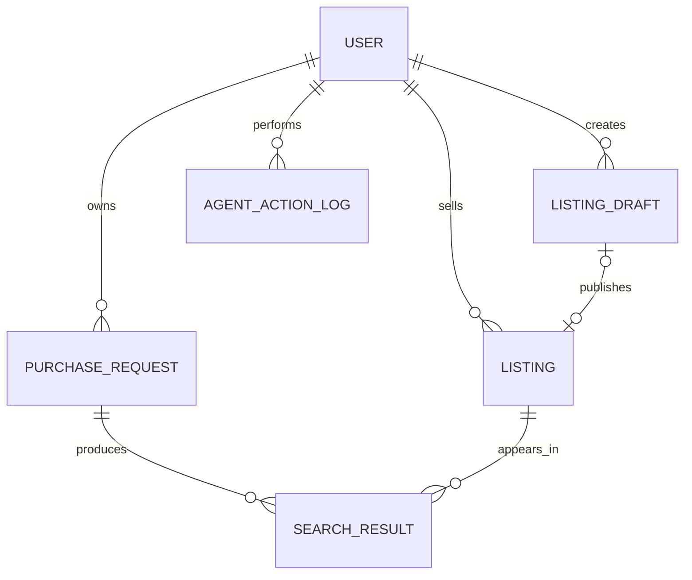

# Step 1 backend API

The routes are the shared HTTP contract for the Web client and the MCP adapter. All IDs are UUIDs and timestamps are ISO 8601. Response objects follow [`schemas/step1.schema.json`](../schemas/step1.schema.json).

## Run locally

Requires Node.js 22.5 or newer. SQLite uses Node's built-in `node:sqlite`; no dependency install is needed.

```sh
cd backend
node server/index.js
```

The API binds to `127.0.0.1:8080` and creates `.local/agent-market.sqlite` with 12 active phone/tablet listings. Set `PORT` or `AGENT_MARKET_DB_PATH` to override these defaults.

The proposal describes PostgreSQL for the eventual service. This thin demo uses SQLite so the API, migrations, and seed data can run locally without a database service. Treat the SQL migration as the local prototype schema; PostgreSQL deployment still needs a PostgreSQL-specific migration and adapter.

## Demo identity only

For local UI/API integration, requests default to demo user `00000000-0000-4000-8000-000000000001` and a human actor. The MCP adapter may pass `X-User-Id`, `X-Actor-Type: AGENT`, and `Idempotency-Key` headers. Those headers are **not authentication**: this server has no login/token verification and must only bind to localhost. Production must derive user and actor identity from verified credentials before exposing these routes.

An Agent may create/update drafts and request search for a purchase request already confirmed by its owner. Only the human owner can publish a listing, confirm a purchase request, or deactivate a listing. A confirmed request is the human authorization prerequisite for later Agent search calls.

## Routes

| Method and path | Purpose | Success |
| --- | --- | --- |
| `GET /api/health` | Health | `{ status, database, step }` |
| `GET /api/categories/:category/schema` | PHONE/TABLET fields and question hints | Category schema object |
| `GET /api/listings?status=ACTIVE&q=` | Public active listings, optional text query | `Listing[]` |
| `GET /api/listings/:id` | Active listing detail (inactive detail is owner-only) | `Listing` |
| `GET /api/listings/mine` | Current user's listings | `Listing[]` |
| `GET /api/listing-drafts/mine` | Current user's unpublished drafts | `ListingDraft[]` |
| `POST /api/listing-drafts` | Create a partial or review-ready draft | `ListingDraft` |
| `PATCH /api/listing-drafts/:id` | Update an owned unpublished draft | `ListingDraft` |
| `POST /api/listing-drafts/:id/publish` | Human approval; creates an ACTIVE listing snapshot | `Listing` |
| `POST /api/listings/:id/drafts` | Start a new draft from an owned active listing | `ListingDraft` |
| `POST /api/listings/:id/deactivate` | Human owner deactivates a listing | `Listing` |
| `GET /api/purchase-requests/:id` | Owner-only draft/confirmed request and review guidance | `PurchaseRequestResponse` |
| `GET /api/purchase-requests/mine` | Current user's private requests | `PurchaseRequest[]` |
| `POST /api/purchase-requests` | Create a private draft | `PurchaseRequest` |
| `PATCH /api/purchase-requests/:id` | Update an owned request; returns it to DRAFT | `PurchaseRequest` |
| `POST /api/purchase-requests/:id/confirm` | Human owner confirms category and budget | `PurchaseRequest` |
| `POST /api/purchase-requests/:id/search` | Search confirmed request against ACTIVE listings | `SearchResult[]` |

Draft creation accepts partial values and returns `missingFields`. Listing publication requires `category`, `model`, and positive `priceKrw`; request confirmation requires `category` and positive `maxBudgetKrw`. Unknown optional values stay `null` or in `missingFields`; the server does not infer them. `conditionPreferences` is an array of `LIKE_NEW`, `GOOD`, and `FAIR`, following the current frontend API draft.

Every Agent write must include `Idempotency-Key` (or a body `requestId`). The key is scoped to user, HTTP operation, and endpoint; retries return the original successful JSON response. Successful and rejected Agent commands are written to `agent_action_logs`. Human UI requests may also supply an idempotency key.

Search uses the Step 1 rule version `step1-rule-v2`: only ACTIVE listings are considered; category, maximum budget, model query, minimum storage, and selected condition constraints are evaluated; hard mismatches are stored as `EXCLUDED`, and the response includes them for MCP consumers. Missing information required to judge an active constraint is never treated as a positive match; such candidates are `NEEDS_CONFIRMATION`. Unrequested optional unknowns are displayed but do not alone prevent MATCH. Each result includes matched, unmet, and missing fields and the listing snapshot. This intentionally small server rule set is an integration baseline for the Search & Matching owner to review.

## Errors

Errors use `{ "code": "...", "message": "...", "details": {} }` where applicable.

| HTTP | Code | Meaning |
| --- | --- | --- |
| 400 | `INVALID_JSON` | Malformed JSON request body |
| 401 | `UNAUTHORIZED` | Invalid demo identity header |
| 403 | `FORBIDDEN` | Different owner or Agent-only-forbidden action |
| 404 | `NOT_FOUND` | Object or route not found |
| 409 | `INVALID_STATE` | State transition or approval prerequisite not met |
| 413 | `PAYLOAD_TOO_LARGE` | Request body exceeds local limit |
| 422 | `VALIDATION_ERROR` | Invalid fields or missing required values |

The local identity headers are a temporary adapter seam, not an authorization system. Purchase requests are only returned from the owner-scoped `mine` route; no seller-facing request route exists.

## Data relationships



The migration also has a separate `idempotency_keys` table. `PUBLISHED` is included as the terminal `ListingDraft` state because the State Rules page defines that transition and says it represents successful Listing creation; the Data Model page's shorter enum omits it. A revision creates a new Draft and only changes its existing Listing after human approval. The demo preserves the Listing ID to match the frontend API draft.

## Purchase intent structuring (Step 1)

`POST /api/purchase-requests` and `PATCH /api/purchase-requests/:id` accept
`naturalLanguageRequest` (up to 10,000 characters) and optional `knownConstraints`.
The latter accepts only category, modelQuery, maxBudgetKrw, storageGb, and
conditionPreferences. Existing structured Web requests continue to work unchanged.
The input contract is `PurchaseRequestDraftInput` in the shared JSON Schema.

```json
{
  "naturalLanguageRequest": "100만 원 이하 태블릿 찾아줘",
  "knownConstraints": { "storageGb": 256 }
}
```

The existing PurchaseRequest response is persisted with `category: "TABLET"`,
`maxBudgetKrw: 1000000`, `storageGb: 256`, and `status: "DRAFT"`. Other optional
conditions remain unknown/unrestricted; no model or product condition is invented.
Agent writes still require an Idempotency-Key. Confirmation remains human-only.
Updating a confirmed request returns it to DRAFT and requires confirmation again.

This is a deterministic, conservative parser, not a server-side LLM or chatbot.
External Agents provide structured conditions for language outside its vocabulary.
Supported inputs include phone/tablet terms, iPhone/iPad/Galaxy S/Galaxy Tab model
families, comma-separated or decimal KRW amounts, upper budget bounds, GB/TB
minimum capacities (1 TB = 1024 GB), and explicit LIKE_NEW/GOOD/FAIR state terms.
`미만` budgets are converted to an inclusive integer KRW maximum by subtracting 1.
Vague prices, multiple alternatives, lower price bounds, unsupported storage bounds,
and negated phrases are left unresolved and produce questions. This module does
not implement model alias matching against listings; matching improvements are a
separate step. No raw natural-language text is retained in the database.

Concrete text/structured conflicts clear the affected condition and return it in
missingFields with a nextQuestion. Conflicting top-level and knownConstraints
values are rejected with 422, as are invalid structured values. An explicit null
or empty optional value clears that condition. A natural-language PATCH preserves
stored fields not mentioned in the request. Required missing category/budget values
produce questions and still block confirmation; optional questions do not add new
mandatory fields. Generated questions are rebuilt after every update so answered questions disappear automatically.

Example unresolved input:

```json
{ "naturalLanguageRequest": "저렴한 태블릿" }
```

This creates a DRAFT with null maxBudgetKrw, missingFields including maxBudgetKrw,
and a question asking for the maximum budget. It cannot be confirmed yet.


## Follow-up questions

Every purchase draft (including structured Web input) returns nextQuestions ordered
by category, maximum budget, model/model family, minimum storage, then condition.
Only category and budget are required for confirmation. Unspecified optional
conditions produce skippable questions without being added to missingFields.
Ambiguous optional constraints remain in missingFields until answered or declined.
Generated prompts are rebuilt after each patch; custom prompts are retained while
unresolved missingFields remain. No extra LLM call is made.

To decline optional questions, PATCH the purchase request with:

```json
{
  "skippedQuestionFields": ["modelQuery", "storageGb", "conditionPreferences"]
}
```

Skip choices are persisted and survive subsequent updates and restarts. This array
replaces prior skip choices; send [] to reopen them. Required fields cannot be
skipped (422). Skipping a populated condition does not clear its value: also send
null (or [] for conditionPreferences) to remove an existing constraint. Updating a
field without supplying skippedQuestionFields reopens that field's question if it
is empty; an actual value removes the question. All edits still reset status to
DRAFT. Existing SQLite databases automatically receive the new JSON column on
startup, preserving existing records.


## Matching rule v2

The matching module independently rejects unconfirmed or invalid purchase
conditions and filters out non-ACTIVE listings. All ACTIVE listings receive a
judgment; EXCLUDED records remain in the API response and storage for diagnostics.
The Web HTTP adapter filters those out of its candidate list.

Model matching uses NFKC/case normalization, Korean aliases (아이폰/iPhone,
아이패드/iPad, 갤럭시/Galaxy, 탭/Tab, 프로/Pro, 에어/Air, 미니/mini,
울트라/Ultra, 플러스/plus/+), and letter-number token boundaries.
Family queries such as iPad, iPad Pro, Galaxy Tab and Galaxy S are broad.
Numbered queries select the exact named variant: Galaxy Tab S9 excludes S9 FE,
iPhone 15 excludes 15 Pro, and iPhone 15 Pro excludes 15 Pro Max.
For all variants of a generation, use the broader family query or submit separate
requests; OR lists are not part of modelQuery. Unknown models use normalized token
sequence matching rather than fuzzy guesses. This does not infer release year,
chipset, generation or equivalence from external product catalogs.

Price equals maximum budget and storage equals minimum capacity both pass.
Condition preferences are an allow-list. A hard violation takes precedence over
missing data. Unknown/invalid required category, model or price, and unknown
storage/condition needed by a constraint yield NEEDS_CONFIRMATION. Declared
missingFields remain unverified even if a corresponding value is populated.
Unknown optional storage, condition, accessories and other declared unknowns are
shown in missingFields but do not alone downgrade a match without a related
constraint. MATCH means requested constraints passed, not that every product
attribute has been verified. No scoring, LLM ranking or Step 2 monitoring is added.


## Agent / Web API connection

Create, patch, confirm, detail and mine purchase endpoints return
PurchaseRequestResponse: all existing PurchaseRequest fields remain at the top
level, with readyForConfirmation, humanApprovalRequired and nextAction added.
These fields are computed API guidance, not client-controlled approval flags.
The Web adapter remains compatible with its existing save/confirm/search calls.

- Incomplete DRAFT: COMPLETE_CONDITIONS / PATCH the condition endpoint.
- Complete DRAFT: REVIEW_AND_CONFIRM / POST confirm, human owner only.
- CONFIRMED: SEARCH_LISTINGS / POST search, owner or authorized Agent.

readyForConfirmation means a DRAFT has valid mandatory category/budget;
optional questions do not block approval. humanApprovalRequired stays true for
all drafts and is false only after human confirmation. Any condition patch resets
status and requires new confirmation. nextAction includes method/path/actor; it
is guidance, never permission to bypass server checks. No unsupported Web deep
link or platform chatbot is introduced.

GET /api/purchase-requests/:id supports Agent-to-Web review handoff by ID and is
owner-only (403 for another owner, 404 for an unknown ID). Category schema replies
preserve their selling fields and additionally expose purchaseRequiredFields,
purchaseOptionalFields and purchaseQuestionHints for MCP clients.

POST search accepts only an empty JSON object or optional requestId. Passing
conditions or another override is a 422 error; update via PATCH and reconfirm.
It returns the existing SearchResult array from rule v2. Agent mutations still
require a request ID/Idempotency-Key and record actions. This is the HTTP seam
for an external MCP adapter; production authentication and the MCP server itself
remain separate work.

Example Agent request:

```http
POST /api/purchase-requests
Content-Type: application/json
X-Actor-Type: AGENT
Idempotency-Key: purchase-draft-001
```

```json
{"naturalLanguageRequest":"100만원 이하 태블릿", "knownConstraints":{"storageGb":256}}
```

Use the returned id to review with GET /api/purchase-requests/:id. The human Web
client POSTs /confirm; the confirmed response then points to /search. The local
identity headers shown here are demo-only and are not authentication.


## Token authentication and MCP integration

GET /api/me returns the bound user, actor type and scopes. Human-only token
management is GET/POST /api/agent-tokens and DELETE /api/agent-tokens/:id.
POST accepts name, scopes (read, listing:write, purchase:write, search) and optional
expiresInDays (1–365). Token plaintext is returned once; storage contains its hash.
Bearer token requests always act as AGENT, regardless of X-Actor-Type.

Demo mode preserves local Web headers. Strict mode requires verified Agent tokens
or a trusted Web server's X-User-Id and X-Web-Secret headers; the current static Web
cannot call strict API directly. GET health is public and now adds authMode.
Token scopes and ownership are both enforced, and Agents cannot publish or confirm.
See [MCP guide](mcp-tools.md) for transport setup and deployment limitations.
