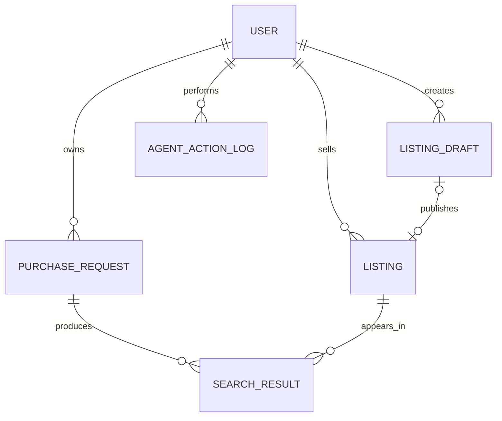

# Step 1 backend API

The routes are the shared HTTP contract for the Web client and the MCP adapter. All IDs are UUIDs and timestamps are ISO 8601. Response objects follow [`schemas/step1.schema.json`](../schemas/step1.schema.json).

## Run locally

Requires Node.js 22.5 or newer. SQLite uses Node's built-in `node:sqlite`; no dependency install is needed.

```sh
node server/index.js
```

The API binds to `127.0.0.1:8080` and creates `.local/agent-market.sqlite` with 12 active phone/tablet listings. Set `PORT` or `AGENT_MARKET_DB_PATH` to override these defaults.

The proposal describes PostgreSQL for the eventual service. This thin demo uses SQLite so the API, migrations, and seed data can run locally without a database service. Treat the SQL migration as the local prototype schema; PostgreSQL deployment still needs a PostgreSQL-specific migration and adapter.

## Demo identity only

For local UI/API integration, requests default to demo user `00000000-0000-4000-8000-000000000001` and a human actor. The MCP adapter may pass `X-User-Id`, `X-Actor-Type: AGENT`, and `Idempotency-Key` headers. Those headers are **not authentication**: this server has no login/token verification and must only bind to localhost. Production must derive user and actor identity from verified credentials before exposing these routes.

An Agent may create/update drafts and request search for a purchase request already confirmed by its owner. Only the human owner can publish a listing, confirm a purchase request, or deactivate a listing. A confirmed request is the human authorization prerequisite for later Agent search calls.

## Routes

| Method and path | Purpose | Success |
| --- | --- | --- |
| `GET /api/health` | Health | `{ status, database, step }` |
| `GET /api/categories/:category/schema` | PHONE/TABLET fields and question hints | Category schema object |
| `GET /api/listings?status=ACTIVE&q=` | Public active listings, optional text query | `Listing[]` |
| `GET /api/listings/:id` | Active listing detail (inactive detail is owner-only) | `Listing` |
| `GET /api/listings/mine` | Current user's listings | `Listing[]` |
| `GET /api/listing-drafts/mine` | Current user's unpublished drafts | `ListingDraft[]` |
| `POST /api/listing-drafts` | Create a partial or review-ready draft | `ListingDraft` |
| `PATCH /api/listing-drafts/:id` | Update an owned unpublished draft | `ListingDraft` |
| `POST /api/listing-drafts/:id/publish` | Human approval; creates an ACTIVE listing snapshot | `Listing` |
| `POST /api/listings/:id/drafts` | Start a new draft from an owned active listing | `ListingDraft` |
| `POST /api/listings/:id/deactivate` | Human owner deactivates a listing | `Listing` |
| `GET /api/purchase-requests/mine` | Current user's private requests | `PurchaseRequest[]` |
| `POST /api/purchase-requests` | Create a private draft | `PurchaseRequest` |
| `PATCH /api/purchase-requests/:id` | Update an owned request; returns it to DRAFT | `PurchaseRequest` |
| `POST /api/purchase-requests/:id/confirm` | Human owner confirms category and budget | `PurchaseRequest` |
| `POST /api/purchase-requests/:id/search` | Search confirmed request against ACTIVE listings | `SearchResult[]` |

Draft creation accepts partial values and returns `missingFields`. Listing publication requires `category`, `model`, and positive `priceKrw`; request confirmation requires `category` and positive `maxBudgetKrw`. Unknown optional values stay `null` or in `missingFields`; the server does not infer them. `conditionPreferences` is an array of `LIKE_NEW`, `GOOD`, and `FAIR`, following the current frontend API draft.

Every Agent write must include `Idempotency-Key` (or a body `requestId`). The key is scoped to user, HTTP operation, and endpoint; retries return the original successful JSON response. Successful and rejected Agent commands are written to `agent_action_logs`. Human UI requests may also supply an idempotency key.

Search uses the Step 1 rule version `step1-rule-v1`: only ACTIVE listings are considered; category, maximum budget, model query, minimum storage, and selected condition constraints are evaluated; hard mismatches are stored as `EXCLUDED`, and the response includes them for MCP consumers. Missing listing data is never treated as a positive match; such candidates are `NEEDS_CONFIRMATION`. Each result includes matched, unmet, and missing fields and the listing snapshot. This intentionally small server rule set is an integration baseline for the Search & Matching owner to review.

## Errors

Errors use `{ "code": "...", "message": "...", "details": {} }` where applicable.

| HTTP | Code | Meaning |
| --- | --- | --- |
| 400 | `INVALID_JSON` | Malformed JSON request body |
| 401 | `UNAUTHORIZED` | Invalid demo identity header |
| 403 | `FORBIDDEN` | Different owner or Agent-only-forbidden action |
| 404 | `NOT_FOUND` | Object or route not found |
| 409 | `INVALID_STATE` | State transition or approval prerequisite not met |
| 413 | `PAYLOAD_TOO_LARGE` | Request body exceeds local limit |
| 422 | `VALIDATION_ERROR` | Invalid fields or missing required values |

The local identity headers are a temporary adapter seam, not an authorization system. Purchase requests are only returned from the owner-scoped `mine` route; no seller-facing request route exists.

## Data relationships



The migration also has a separate `idempotency_keys` table. `PUBLISHED` is included as the terminal `ListingDraft` state because the State Rules page defines that transition and says it represents successful Listing creation; the Data Model page's shorter enum omits it. A revision creates a new Draft and only changes its existing Listing after human approval. The demo preserves the Listing ID to match the frontend API draft.
